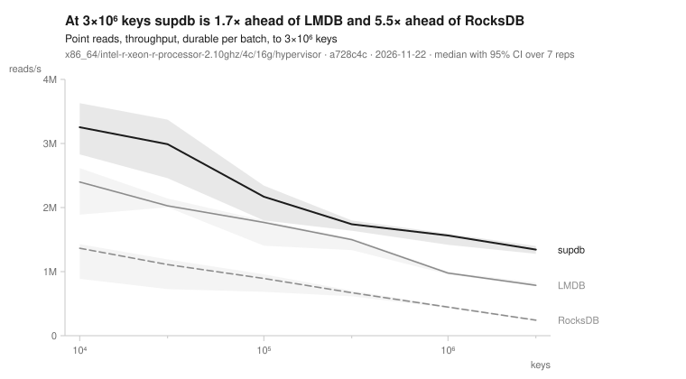
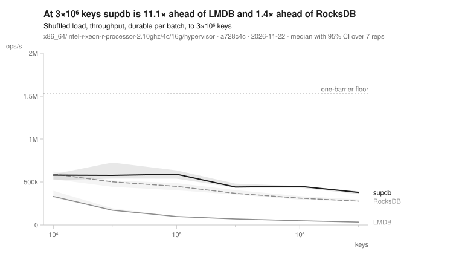
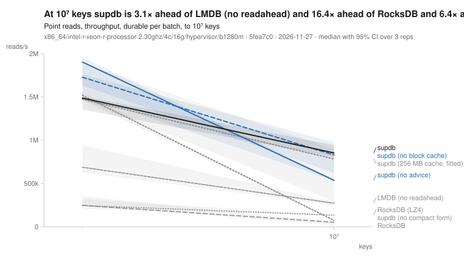

# Supdb

A read-optimized embedded key-multivalue store, in Rust. A key holds an
ordered run of values; appends are cheap, and the on-disk layout spends space
to make point reads and ordered scans fast. One reader serves both a
memory-mapped file on a server and a browser fetching byte ranges out of
object storage: the read path compiles to wasm and answers the same question
from either source.

- A durable commit is one log append and one `fdatasync`: the WAL's, or, for
  keys arriving above the store's greatest, the segment they are written
  into. Batches are atomic, and `Txn` builds one.
- Data lives in immutable sealed segments behind a flat hash index. Compaction
  partitions by key range, so a read routes to one partition and the recent
  pieces over it.
- Deletes are tombstones the merge collects. Small runs are stored inline in
  the index record, so reading them touches no data block; a run of one width
  is stored without prefixes and read as a memcpy.
- Every data block and every piece of the key index is checksummed: a damaged
  key index fails the open, and a damaged block fails the read that reaches
  it, rather than answering wrongly.
- A finished segment can be published encrypted and read in place, natively
  and in the browser: an authenticated envelope around the file, under a
  cipher the caller supplies, decrypted once and read after that at the
  plain file's speed.
- A live store opens under a key, either of two ways: the kernel encrypts
  its directory and the store reads as it does without one, or the store
  seals everything it writes under a cipher the caller supplies, on any
  filesystem, and reads through a cache of plaintext of a size the caller
  sets, so a store larger than memory runs in it.

## Benchmarks

The suite in [`bench/`](bench/) measures supdb against LMDB and RocksDB on
ordered and shuffled loads, point reads, ordered scans and the YCSB core
mixes, over a ladder of store sizes from ten thousand keys to past the
machine's memory, and against floors that read the host with no engine in
the way (a durable framed append, a mapped sequential read, a dependent load,
a fresh page). Every comparison is
guarantee-matched, durable against durable and buffered against buffered.
A run writes one row of raw samples; `bench figures` draws every figure
from the committed rows, and `bench gate` fails a change whose row is worse
than the last ten of its machine class. [`bench/DESIGN.md`](bench/DESIGN.md)
is the specification.

What the curves show is in the figures, drawn from the committed rows into
[`docs/figures/`](docs/figures/) and held to them by the checks; a summary
in words goes stale with the next row. Three of them, from the newest row of
each scale, on the host class each figure names:







The bounded figure reads its rows by arm: `supdb` is the engine's defaults
at the row's commit, `supdb-autozpages` the compact form's controller named
on its own where it was not yet the default, and `supdb-nozpages` the raw
form alone where it is. The rest of the set, every workload and option, is
under `docs/figures/` by scale and machine class.

### Reproducing a row

The quick ladder runs on a hosted runner from a fork, with no toolchain
installed anywhere:

1. Fork the repository.
2. Under Actions, choose the `ci` workflow and run it by hand. Its `arms`
   input takes a comma-separated list, `supdb,lmdb` for instance, and runs
   those arms alone in a fraction of the time; empty, it runs every arm.
3. When the `quick` job ends, download its `quick-row` artifact: one JSON
   row under `quick/` holding the raw per-rep samples of every quantity and
   the machine as the row records it, with the gate's verdict in the job's
   log. [`bench/DESIGN.md`](bench/DESIGN.md) names every quantity and says
   how it is measured.

A run of every arm takes twenty to thirty minutes on `ubuntu-latest`. The
row's class is the runner's CPU model, and the hosted runners rotate between
several, so the gate has a band for a class only once three rows of it are
committed; the `bank-row` workflow proposes the hosted rows as a pull
request after each merge, and merging one is a person's decision.

## Usage

```toml
[dependencies]
supdb = { git = "https://github.com/bfulton/supdb" }
```

A store: append values to keys, commit, read them back.

```rust
use supdb::{Db, Options};

let mut db = Db::create(std::path::Path::new("./store"), Options::default())?;

db.append(b"user:42", b"logged in");
db.append(b"user:42", b"opened report");
db.put(b"config", b"v2");            // replace: delete and append in one batch
db.commit()?;                        // the durability point

let mut tx = db.begin();             // atomic: all of it or none of it
tx.append(b"user:42", b"logged out");
tx.delete(b"config");
tx.commit()?;

db.read_all(b"user:42", |v| println!("{}", String::from_utf8_lossy(v)))?;
let n = db.count(b"user:42")?;       // costs a lookup, not a read
db.scan(b"user:", 100, |key, value| { /* in key order */ })?;
db.close()?;
```

Readers on other threads, beside the writer, with no lock between them: a
`Reader` has the read API, reads whatever the writer has committed, and
holds a snapshot when asked to.

```rust
use supdb::{Db, Isolation, Options};

let mut db = Db::create(std::path::Path::new("./store"), Options::default())?;
let reader = db.reader()?;           // one per thread; `Send`, not `Sync`
let t = std::thread::spawn(move || {
    let mut n = 0;
    reader.read_all(b"user:42", |_v| n += 1).unwrap();   // every commit before it
    reader.snapshot();               // the store as of now, until `release`
    reader.scan(b"user:", 100, |_k, _v| {}).unwrap();
    reader.release();
    reader.set_isolation(Isolation::Dirty);   // the writer's staged batch too
    n
});
db.append(b"user:42", b"logged in");
db.commit()?;                        // the reader sees this from here on
```

A checkpoint: the store as of the call, made a store of its own at a path
that does not exist yet. The segments are hard-linked where the path is on
the store's filesystem, so it costs a flush and takes no space until the
live store's merges retire what the two share; elsewhere they are copied.

```rust
db.checkpoint(std::path::Path::new("./store-backup"))?;
let backup = Db::open(std::path::Path::new("./store-backup"), Options::default())?;
```

A write-once segment: sorted input in, one immutable file out, read by the
same reader the store uses.

```rust
use supdb::{Blob, MmapBytes, SegmentOptions, SegmentWriter};

let path = std::path::Path::new("./day.sup");
let mut w = SegmentWriter::create(path, &SegmentOptions::default())?;
for (key, values) in sorted_input {   // keys in byte order
    w.begin(key)?;
    for v in values { w.value(v); }
    w.end()?;
}
w.finish(1)?;

let seg = Blob::open(MmapBytes::open(path)?)?;
seg.read_all(b"term", |v| { /* zero-copy borrow into the mapping */ })?;
```

A segment's head reserve is what lets a reader's first probe cover the index
without a second round trip, and it has to be sized before the first key is
written. `supdb::reserve` computes it rather than guessing, so a small segment
does not carry a large one's worth of zeroes. With the whole input in hand,
`SegmentWriter::write_sorted` does it for you. Without: run the lengths through
`reserve::Planner`, which holds aggregates rather than records, then stream
through `SegmentWriter::create_with(path, opts, write, reserve)`, which takes
the per-file settings -- compression, inline runs, sync spreading -- and the
reserve together, since all of them must be set before the first key.

The same segment in a browser, over ranged HTTP from a Web Worker:

```js
import { openCached } from "./supdb.mjs";
import { CachedBytes, httpRangeFetcher } from "./cache.mjs";

const cache = await CachedBytes.open({
  name: "day",                          // sparse pages persist in OPFS under this name
  fetcher: httpRangeFetcher(url),
  budgetBytes: 32 << 20,
});
const reader = await openCached(wasm, cache);
const key = new TextEncoder().encode("term");
await reader.ensure([key]);             // fetch the ranges the read will touch
const values = reader.lookup(key);      // then read synchronously, with no miss
```

`web/README.md` covers the three byte sources -- memory, OPFS, and a
budgeted page cache over HTTP or S3 -- and why the reader has to run in a
Worker.

A segment published encrypted, and read at the plain file's speed:

```rust
use supdb::crypt::{self, EncryptOptions, Encrypted};
use supdb::{Blob, MmapBytes};

// `key` is your cipher behind `supdb::crypt::Aead`: supdb ships none.
// `examples/crypt.rs` is the adapter for AES-256-GCM.
let mut out = std::fs::File::create("./day.sup.enc")?;
crypt::encrypt(&MmapBytes::open(path)?, &mut out, &key, &EncryptOptions::default())?;

let stored = MmapBytes::open(std::path::Path::new("./day.sup.enc"))?;
let seg = Blob::open(Encrypted::open(stored, key)?)?;   // a wrong key fails here
seg.read_all(b"term", |v| { /* a borrow, as from the plain file */ })?;
```

```js
import { decryptingFetcher, importKey } from "./crypt.mjs";

const cache = await CachedBytes.open({
  name: "day",
  fetcher: decryptingFetcher(httpRangeFetcher(url), await importKey(rawAesKey)),
  budgetBytes: 32 << 20,
});
```

A reader decrypts each part of the file once, the first time a read touches
it, keeps it, and lends it from then on as a mapping lends: after that first
touch a read costs what it costs on the plain file. The first touch runs at
your cipher's speed, so the cipher matters; `cargo run --release --example
crypt_cost` prints its rate and every read's cost beside the plain read's.
What a reader keeps is memory the size of what it has read
(`ReadOptions::keep_bytes` bounds it, down to nothing for a file larger than
memory, where each read decrypts what it touches). In the browser the
decryption happens once, at the fetch, costs no extra round trip, and the
cache holds plaintext.

The envelope hides the file's bytes and refuses any change to them: a byte
altered, a part moved or taken from another file, a file cut short. It does
not hide the file's length, and an older envelope served whole in place of a
newer one is still a valid envelope. It covers a finished file; a live
store takes a key in one of two other ways, below. The `supdb::crypt` module docs have
the layout and how many files one key should be used for.

A live store is kept under a key one of two ways, and `Options::encryption`
says which: `Encryption::None`, the default, `Encryption::Kernel` or
`Encryption::Cipher`. Under the kernel's:

```rust
use supdb::{Db, DirKey, Encryption, Options};

let opts = Options {
    encryption: Encryption::Kernel(DirKey::new(key_bytes)),   // 32 bytes, yours to keep
    ..Options::default()
};
let mut db = Db::create(std::path::Path::new("./store"), opts)?;
```

The kernel encrypts the store's directory (Linux's file encryption): every
file the store writes is ciphertext on the device and plaintext in the page
cache, so the store reads exactly as it does without a key, by borrowing
from its files' mappings. `create` encrypts the directory before it writes
anything and refuses where it cannot, so a store given a key never writes
plaintext; `open` refuses a directory that is not under the key it was
given. It needs a filesystem with the feature (ext4 or f2fs with `encrypt`
on) and protects the device: file contents and names, not sizes, and not
against whoever can read the files while the kernel holds the key
(`supdb::dirkey::lock` gives it up). The `supdb::dirkey` module docs have
the rest.

Under a cipher you supply:

```rust
use supdb::{Db, Encryption, Options, StoreCipher};

// `Gcm` is your cipher behind `supdb::crypt::Aead`, as for an envelope:
// once under your key, and as the constructor of one from a key the store
// draws. `cache_bytes` is the plaintext the store may hold in memory.
let cipher = StoreCipher::new(Gcm::new(&my_key), Gcm::new)
    .key_id(1)
    .cache_bytes(4 << 30);
let opts = Options {
    encryption: Encryption::Cipher(cipher),
    ..Options::default()
};
let mut db = Db::create(std::path::Path::new("./store"), opts)?;
```

Everything the store writes to its directory is sealed and authenticated:
the segments, the log, the manifest, and the names of the files, which in
a plain store carry the first bytes of keys. Your cipher wraps one key, the
store's own, at `create` and at each `open`, so your key can be slow to
reach or kept elsewhere; the store draws a key for each file and makes
their ciphers with your constructor. It needs no filesystem feature and no
privilege. `create` wants an empty directory; `open` refuses a store that
is not under the cipher it was given, and a store under a cipher is refused
where none is given. `supdb::cipher_key_id` reads back the `key_id` of a
directory without the key, and `supdb::cipher_rewrap` hands a store from
one of your keys to another by rewriting that one wrapped key.

The cipher is in your process, so the kernel's page cache cannot hold the
store's plaintext, and the store keeps a cache of its own: a chunk of a
file is decrypted where it is first read, borrowed from in place as a
plain store borrows from the page cache, and given back once the cache is
past `cache_bytes` and the chunk has not been read lately. A store runs in
the cache it is given whatever its size, at the rate of its misses, and an
`open` decrypts what an open reads of each file, not the store. Unset, the
cache follows the room: the memory the process may use, less what the
process itself holds and a margin, read again as the store runs. What the
store holds in plaintext is memory the kernel cannot take back, as it can
take back a plain store's page cache, so the store gives way itself as the
process grows. A size you set is held whatever the process does beside it.
A file being written is in memory whole until it is sealed into the
directory, so beside the cache the store holds what it has in flight, a
seal's or a merge's output (`Options::seal_bytes`, `partition_bytes`). The
store's own work waits for a cache that has run past its budget, and a read
of yours waits only for one further past it. What the cache does not count is what any store holds
in the process: its unsealed writes and the block cache, which has a bound
of its own (`Options::scan_cache_bytes`).

A file's bytes are checked where they are decrypted. A byte changed in the
marker, a manifest or a file's header is refused at the `open`, a byte
changed in the log ends the log as a torn write does, and a byte changed
in a segment is refused at the read that first wants it: that read
answers with an error, and so does every operation after it. The whole
directory put back to an older copy of itself is not detected.

What it costs beside the cipher: an ordered load is written to the log as
well as to its segment, and it is Linux only. Every option a store in the
clear runs with, a store under a cipher runs with; one choice is made
differently, in that `ZPages::Auto` leaves such a store in the raw form
unless `Options::zpages_under_cipher` is set, and `ZPages::Always` builds
the compact form there as anywhere, in either of its layouts. One mechanism
that reads a file as its mapping lies does not act under a cipher: the
copy of the ordered index's heads (`Options::heads_owned`) is not made.
`Db::cipher_counts` says what
the cache holds, has decrypted and has given back. `cargo run --release
--example cipher_store` has the adapter and opens a store under a cache
smaller than it, and the `supdb::db::vault` module docs have the layout,
the keys and what is and is not refused.

Which of the two a store wants: `Encryption::Kernel` keeps the kernel's
page cache and every read path as it is, on ext4 or f2fs with `encrypt`
on; it does not authenticate, and the files read as plaintext to whatever
can read them while the kernel holds the key. `Encryption::Cipher` goes
wherever Linux does, authenticates, leaves files that are ciphertext
wherever they are copied, and reads through a cache you size. It is one or
the other: a store under both would encrypt every byte twice for nothing,
so the option takes one, and a store kept one way is refused when it is
opened the other.

## Building

```sh
sh scripts/deps.sh             # the toolchain pieces the checks need, where missing
cargo build --release
cargo test --profile checked  # the release profile with overflow checks and debug assertions on
sh scripts/check.sh            # build, test, stride, lint, wasm, bench, lists -- the default set
sh scripts/check.sh quick      # one quick-scale measurement, on an otherwise idle machine
sh scripts/check.sh fscrypt    # a store under a key, on a filesystem scripts/fscrypt.sh makes
sh scripts/check.sh cost       # what a store in the clear pays an operation, against the base
sh scripts/check.sh cross-arm  # the library's tests for aarch64, under qemu-user
sh scripts/check.sh machine    # the suite's machine capture, on an Apple Silicon host
sh web/build.sh                # the browser module
```

## Documentation

| where | what |
|---|---|
| `bench/DESIGN.md` | the benchmark suite: workloads, arms, the ladder, the gate, the figures |
| `docs/engine.md` | the engine's design and the measurements each decision cites |
| `docs/index-theory.md` | the index layout, and what theory predicts that measurement does not show |
| `web/README.md` | the browser reader |
| `ROADMAP.md` | what the engine and the suite still need, and the losses accepted by design |

## Status

A prototype. A store records its format version in its manifest
(`supdb::STORE_FORMAT`). A release opens a store of any version
from `supdb::STORE_FORMAT_OLDEST` to its own, and refuses any other at
open, naming both versions, before it sweeps, replays or rewrites
anything; it never opens a store it would misread. Each file also carries
a magic that moves whenever an older reader would misread it, so a reader
refuses the file rather than serving wrong bytes.

A store is open in one place at a time. A second open, from another process
or from the same one, fails at once while the first holds the store's
`LOCK`, and the lock goes with the process that holds it.

## License

MIT. See `LICENSE`.
