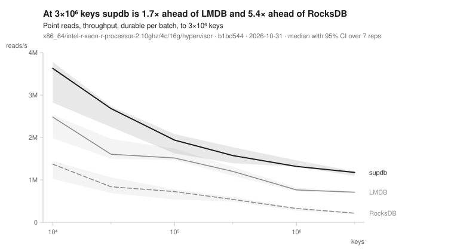
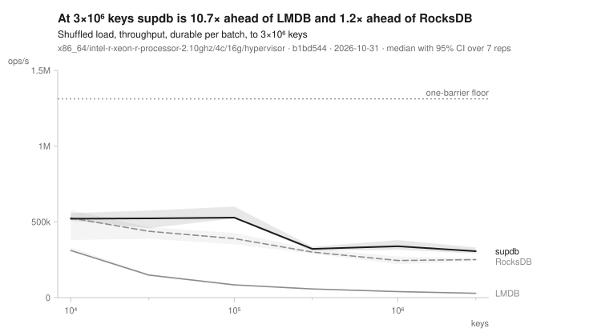
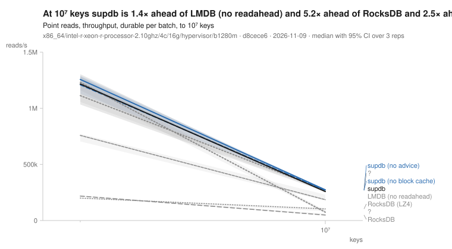

# Supdb

A read-optimized embedded key-multivalue store, in Rust. A key holds an
ordered run of values; appends are cheap, and the on-disk layout spends space
to make point reads and ordered scans fast. One reader serves both a
memory-mapped file on a server and a browser fetching byte ranges out of
object storage: the read path compiles to wasm and answers the same question
from either source.

- A durable commit is one log append and one `fdatasync`: the WAL's, or, for
  keys arriving above the store's greatest, the segment they are written
  into. Batches are atomic, and `Txn` builds one.
- Data lives in immutable sealed segments behind a flat hash index. Compaction
  partitions by key range, so a read routes to one partition and the recent
  pieces over it.
- Deletes are tombstones the merge collects. Small runs are stored inline in
  the index record, so reading them touches no data block; a run of one width
  is stored without prefixes and read as a memcpy.
- Every data block and every piece of the key index is checksummed: a damaged
  key index fails the open, and a damaged block fails the read that reaches
  it, rather than answering wrongly.

## Benchmarks

The suite in [`bench/`](bench/) measures supdb against LMDB and RocksDB on
ordered and shuffled loads, point reads, ordered scans and the YCSB core
mixes, over a ladder of store sizes from ten thousand keys to past the
machine's memory, and against floors that read the host with no engine in
the way (a durable framed append, a mapped sequential read, a dependent load,
a fresh page). Every comparison is
guarantee-matched, durable against durable and buffered against buffered.
A run writes one row of raw samples; `bench figures` draws every figure
from the committed rows, and `bench gate` fails a change whose row is worse
than the last ten of its machine class. [`bench/DESIGN.md`](bench/DESIGN.md)
is the specification.

What the curves show is in the figures, drawn from the committed rows into
[`docs/figures/`](docs/figures/) and held to them by the checks; a summary
in words goes stale with the next row. Three of them, from the newest row of
each scale, on the host class each figure names:







The bounded figure reads its rows by arm: `supdb` is the engine's defaults
at the row's commit, `supdb-autozpages` the compact form's controller named
on its own where it was not yet the default, and `supdb-nozpages` the raw
form alone where it is. The rest of the set, every workload and option, is
under `docs/figures/` by scale and machine class.

### Reproducing a row

The quick ladder runs on a hosted runner from a fork, with no toolchain
installed anywhere:

1. Fork the repository.
2. Under Actions, choose the `ci` workflow and run it by hand. Its `arms`
   input takes a comma-separated list, `supdb,lmdb` for instance, and runs
   those arms alone in a fraction of the time; empty, it runs every arm.
3. When the `quick` job ends, download its `quick-row` artifact: one JSON
   row under `quick/` holding the raw per-rep samples of every quantity and
   the machine as the row records it, with the gate's verdict in the job's
   log. [`bench/DESIGN.md`](bench/DESIGN.md) names every quantity and says
   how it is measured.

A run of every arm takes twenty to thirty minutes on `ubuntu-latest`. The
row's class is the runner's CPU model, and the hosted runners rotate between
several, so the gate has a band for a class only once three rows of it are
committed; the `bank-row` workflow proposes the hosted rows as a pull
request after each merge, and merging one is a person's decision.

## Usage

```toml
[dependencies]
supdb = { git = "https://github.com/bfulton/supdb" }
```

A store: append values to keys, commit, read them back.

```rust
use supdb::{Db, Options};

let mut db = Db::create(std::path::Path::new("./store"), Options::default())?;

db.append(b"user:42", b"logged in");
db.append(b"user:42", b"opened report");
db.put(b"config", b"v2");            // replace: delete and append in one batch
db.commit()?;                        // the durability point

let mut tx = db.begin();             // atomic: all of it or none of it
tx.append(b"user:42", b"logged out");
tx.delete(b"config");
tx.commit()?;

db.read_all(b"user:42", |v| println!("{}", String::from_utf8_lossy(v)))?;
let n = db.count(b"user:42")?;       // costs a lookup, not a read
db.scan(b"user:", 100, |key, value| { /* in key order */ })?;
db.close()?;
```

Readers on other threads, beside the writer, with no lock between them: a
`Reader` has the read API, reads whatever the writer has committed, and
holds a snapshot when asked to.

```rust
use supdb::{Db, Isolation, Options};

let mut db = Db::create(std::path::Path::new("./store"), Options::default())?;
let reader = db.reader()?;           // one per thread; `Send`, not `Sync`
let t = std::thread::spawn(move || {
    let mut n = 0;
    reader.read_all(b"user:42", |_v| n += 1).unwrap();   // every commit before it
    reader.snapshot();               // the store as of now, until `release`
    reader.scan(b"user:", 100, |_k, _v| {}).unwrap();
    reader.release();
    reader.set_isolation(Isolation::Dirty);   // the writer's staged batch too
    n
});
db.append(b"user:42", b"logged in");
db.commit()?;                        // the reader sees this from here on
```

A write-once segment: sorted input in, one immutable file out, read by the
same reader the store uses.

```rust
use supdb::{Blob, MmapBytes, SegmentOptions, SegmentWriter};

let path = std::path::Path::new("./day.sup");
let mut w = SegmentWriter::create(path, &SegmentOptions::default())?;
for (key, values) in sorted_input {   // keys in byte order
    w.begin(key)?;
    for v in values { w.value(v); }
    w.end()?;
}
w.finish(1)?;

let seg = Blob::open(MmapBytes::open(path)?)?;
seg.read_all(b"term", |v| { /* zero-copy borrow into the mapping */ })?;
```

A segment's head reserve is what lets a reader's first probe cover the index
without a second round trip, and it has to be sized before the first key is
written. `supdb::reserve` computes it rather than guessing, so a small segment
does not carry a large one's worth of zeroes. With the whole input in hand,
`SegmentWriter::write_sorted` does it for you. Without: run the lengths through
`reserve::Planner`, which holds aggregates rather than records, then stream
through `SegmentWriter::create_with(path, opts, write, reserve)`, which takes
the per-file settings -- compression, inline runs, sync spreading -- and the
reserve together, since all of them must be set before the first key.

The same segment in a browser, over ranged HTTP from a Web Worker:

```js
import { openCached } from "./supdb.mjs";
import { CachedBytes, httpRangeFetcher } from "./cache.mjs";

const cache = await CachedBytes.open({
  name: "day",                          // sparse pages persist in OPFS under this name
  fetcher: httpRangeFetcher(url),
  budgetBytes: 32 << 20,
});
const reader = await openCached(wasm, cache);
const key = new TextEncoder().encode("term");
await reader.ensure([key]);             // fetch the ranges the read will touch
const values = reader.lookup(key);      // then read synchronously, with no miss
```

`web/README.md` covers the three byte sources -- memory, OPFS, and a
budgeted page cache over HTTP or S3 -- and why the reader has to run in a
Worker.

## Building

```sh
sh scripts/deps.sh             # the toolchain pieces the checks need, where missing
cargo build --release
cargo test --profile checked  # the release profile with overflow checks and debug assertions on
sh scripts/check.sh            # build, test, lint, wasm, bench -- what CI runs
sh scripts/check.sh quick      # one quick-scale measurement, on an otherwise idle machine
sh web/build.sh                # the browser module
```

## Documentation

| where | what |
|---|---|
| `bench/DESIGN.md` | the benchmark suite: workloads, arms, the ladder, the gate, the figures |
| `docs/engine.md` | the engine's design and the measurements each decision cites |
| `docs/index-theory.md` | the index layout, and what theory predicts that measurement does not show |
| `web/README.md` | the browser reader |
| `ROADMAP.md` | what the engine and the suite still need, and the losses accepted by design |

## Status

A prototype. A store records its format version in its manifest
(`supdb::STORE_FORMAT`, version 1). A release opens a store of any version
from `supdb::STORE_FORMAT_OLDEST` to its own, and refuses any other at
open, naming both versions, before it sweeps, replays or rewrites
anything; it never opens a store it would misread. Each file also carries
a magic that moves whenever an older reader would misread it, so a reader
refuses the file rather than serving wrong bytes.

A store is open in one place at a time. A second open, from another process
or from the same one, fails at once while the first holds the store's
`LOCK`, and the lock goes with the process that holds it.

## License

MIT. See `LICENSE`.
